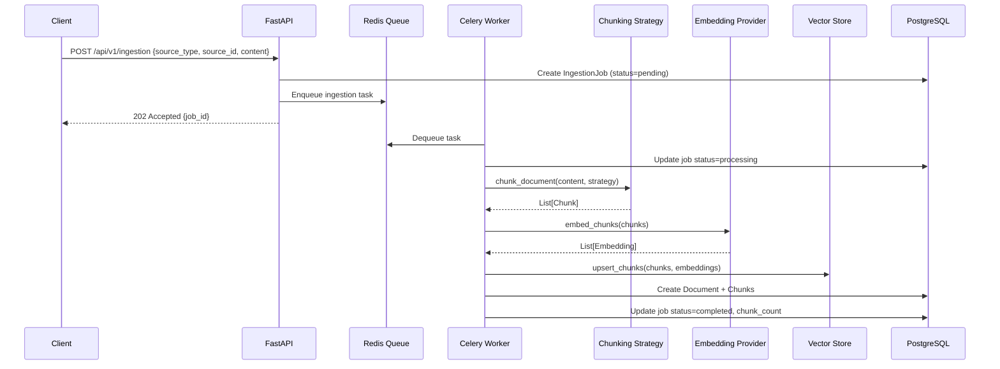
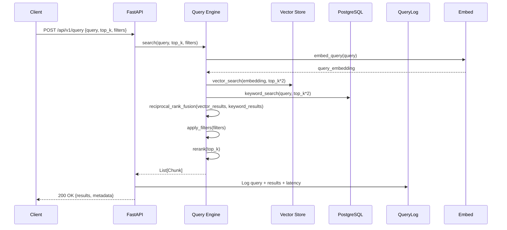
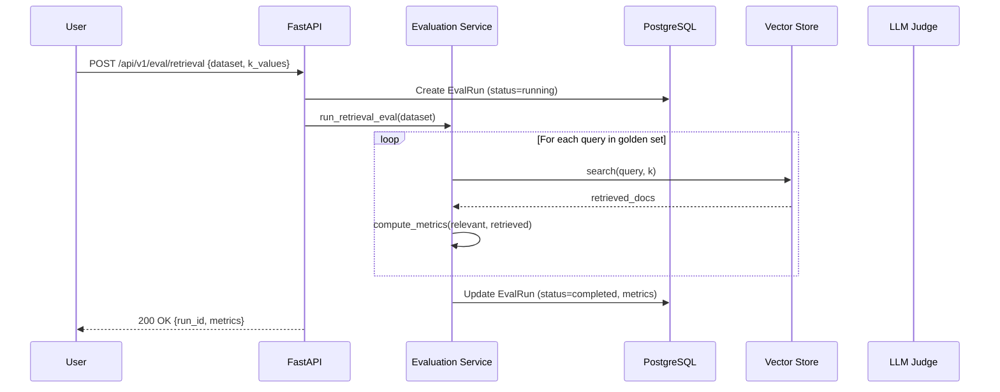

# ContextForge Architecture Documentation

## System Overview

ContextForge is a modular, production-grade RAG platform built on a microservices-ready architecture. The system follows clean architecture principles with clear separation between API layer, core business logic, data access, and infrastructure concerns.

```mermaid
graph TB
    subgraph "External Clients"
        REST[REST API Clients]
        MCP_CLIENT[MCP Clients<br/>Claude Desktop, Cursor]
        CLI[CLI / SDK]
    end

    subgraph "API Gateway Layer"
        LB[Load Balancer<br/>ALB / NGINX]
        GW[FastAPI Application]
        MW[Middleware Stack]
    end

    subgraph "Middleware Stack"
        REQ_ID[Request ID]
        RATE_LIMIT[Rate Limiter<br/>Token Bucket]
        METRICS[Prometheus Metrics]
        CORS[CORS]
        GZIP[GZip Compression]
    end

    subgraph "Core Services"
        ING_SVC[Ingestion Service]
        QUERY_SVC[Query Service]
        EVAL_SVC[Evaluation Service]
        DOC_SVC[Document Service]
    end

    subgraph "Ingestion Pipeline"
        CHUNK[Chunking Strategies]
        EMBED[Embedding Providers]
        VECTOR[Vector Store Adapters]
    end

    subgraph "Chunking Strategies"
        SEMANTIC[Semantic<br/>Embedding Similarity]
        HIERARCHICAL[Hierarchical<br/>Parent/Child]
        CODE[Code-Aware<br/>tree-sitter AST]
        FIXED[Fixed-Size<br/>Recursive Split]
    end

    subgraph "Embedding Providers"
        OPENAI[OpenAI / Azure]
        BEDROCK[AWS Bedrock]
        LOCAL[Local<br/>sentence-transformers]
    end

    subgraph "Vector Stores"
        PGVECTOR[pgvector<br/>HNSW Index]
        FAISS[FAISS<br/>Local Dev]
        WEAVIATE[Weaviate<br/>Enterprise]
    end

    subgraph "Async Processing"
        CELERY[Celery Workers]
        BEAT[Celery Beat<br/>Scheduler]
        REDIS_Q[(Redis Queue)]
    end

    subgraph "Data Layer"
        PG[(PostgreSQL<br/>+ pgvector)]
        REDIS[(Redis<br/>Cache/Rate Limit)]
        FAISS_IDX[(FAISS Index<br/>File)]
        WV[(Weaviate<br/>Cluster)]
    end

    subgraph "Observability"
        OTEL[OpenTelemetry<br/>Collector]
        TEMPO[Tempo<br/>Traces]
        PROM[Prometheus<br/>Metrics]
        GRAF[Grafana<br/>Dashboards]
        LOGS[Structured Logs<br/>JSON]
    end

    REST --> LB
    MCP_CLIENT --> LB
    CLI --> LB
    LB --> GW
    GW --> MW
    MW --> REQ_ID
    MW --> RATE_LIMIT
    MW --> METRICS
    MW --> CORS
    MW --> GZIP
    GW --> ING_SVC
    GW --> QUERY_SVC
    GW --> EVAL_SVC
    GW --> DOC_SVC
    ING_SVC --> CHUNK
    ING_SVC --> EMBED
    ING_SVC --> VECTOR
    CHUNK --> SEMANTIC
    CHUNK --> HIERARCHICAL
    CHUNK --> CODE
    CHUNK --> FIXED
    EMBED --> OPENAI
    EMBED --> BEDROCK
    EMBED --> LOCAL
    VECTOR --> PGVECTOR
    VECTOR --> FAISS
    VECTOR --> WEAVIATE
    ING_SVC --> CELERY
    CELERY --> REDIS_Q
    BEAT --> REDIS_Q
    CELERY --> PG
    CELERY --> REDIS
    CELERY --> FAISS_IDX
    CELERY --> WV
    QUERY_SVC --> VECTOR
    QUERY_SVC --> PG
    EVAL_SVC --> PG
    DOC_SVC --> PG
    GW --> OTEL
    CELERY --> OTEL
    OTEL --> TEMPO
    OTEL --> PROM
    PROM --> GRAF
    GW --> LOGS
    CELERY --> LOGS
```



---

## Component Responsibilities

### 1. API Gateway Layer (`src/contextforge/main.py`)

**FastAPI Application** - Central entry point with:
- Lifespan management (startup/shutdown)
- Middleware stack (order matters - outer to inner)
- Exception handling with structured error responses
- Health check and metrics endpoints
- Router registration (ingestion, query, documents, evaluation)

**Middleware Stack** (execution order: last added = outermost):
1. **GZipMiddleware** - Response compression (>1KB)
2. **CORSMiddleware** - Cross-origin requests
3. **RequestIDMiddleware** - UUID per request, propagated to logs/traces
4. **MetricsMiddleware** - Prometheus counters/histograms
5. **RateLimitMiddleware** - Token bucket via Redis (placeholder for full impl)

### 2. Configuration (`src/contextforge/config.py`)

**Pydantic Settings v2** - Environment-driven configuration:
- Type-safe with validation (PostgresDsn, RedisDsn, Literal enums)
- Computed fields (sync DB URL for Alembic)
- Field validators (secret key, required URLs)
- Model validator (at least one embedding provider)
- Cached via `@lru_cache` for singleton access

### 3. Data Layer (`src/contextforge/storage/`)

#### Database (`database.py`)
- **Async SQLAlchemy 2.0** with asyncpg driver
- Connection pooling (configurable size, overflow, timeout)
- pgvector extension enabled on init
- Base model with JSONB type mapping
- Session management with automatic commit/rollback

#### Models
| Model | Table | Purpose |
|-------|-------|---------|
| Document | `documents` | Ingested documents with metadata, content hash |
| Chunk | `chunks` | Document chunks with pgvector embeddings |
| IngestionJob | `ingestion_jobs` | Async job tracking with status |
| QueryLog | `query_logs` | Search queries for analytics |
| Feedback | `feedback` | User feedback on results |
| EvalRun | `eval_runs` | Evaluation run history |

#### Repositories (`repositories/`)
- **BaseRepository** - Generic CRUD with async session
- **DocumentRepository** - Document + chunk operations
- **ChunkRepository** - Vector search, hybrid search
- **IngestionJobRepository** - Job status updates
- **QueryLogRepository** - Query analytics
- **FeedbackRepository** - Feedback collection
- **EvalRunRepository** - Evaluation persistence

### 4. Ingestion Pipeline (`src/contextforge/ingestion/` - to be implemented)

**Core Flow**:
```
Document Input → Chunking Strategy → Embedding Provider → Vector Store → PostgreSQL
```

**Chunking Strategies** (pluggable via `ChunkingStrategy` protocol):
- **Semantic**: Split by embedding similarity threshold (default 0.7)
- **Hierarchical**: Parent (1024 tokens) + Child (256 tokens) with overlap
- **Code-Aware**: tree-sitter AST parsing (function/class boundaries)
- **Fixed-Size**: Recursive separator splitting (\n\n, \n, ., space)

**Embedding Providers** (pluggable via `EmbeddingProvider` protocol):
- OpenAI / Azure OpenAI (text-embedding-3-large/small)
- AWS Bedrock (Titan, Cohere)
- Local sentence-transformers (BAAI/bge-m3, etc.)

**Vector Stores** (pluggable via `VectorStore` protocol):
- pgvector with HNSW (production)
- FAISS (local development)
- Weaviate (enterprise)

### 5. Query Engine (to be implemented)

**Hybrid Search**:
1. Vector similarity search (cosine/L2/inner product)
2. Keyword search (PostgreSQL tsvector/BM25)
3. Reciprocal Rank Fusion (RRF) for result merging
4. Metadata filtering (source_type, date, custom JSONB)
5. Configurable top-k, score threshold

### 6. Evaluation Framework (`src/contextforge/evaluation/`)

#### Retrieval Metrics (`retrieval/metrics.py`)
- **MRR@k**: Mean Reciprocal Rank
- **nDCG@k**: Normalized Discounted Cumulative Gain
- **Recall@k**: Fraction of relevant retrieved
- **Precision@k**: Fraction of retrieved relevant
- **Latency**: p50, p95, p99 percentiles
- **Threshold Gates**: MRR@10 ≥ 0.65, p95 < 800ms

#### Generation Metrics (`generation/`)
- **RAGAS**: Faithfulness, Answer Relevancy, Context Precision/Recall
- **LLM-as-Judge**: Custom criteria (correctness, completeness, conciseness)
- **Pairwise Comparison**: A vs B scoring

#### Chunking/Embedding Metrics (`chunking/`, `embedding/`)
- Chunk quality (coherence, boundary preservation)
- Embedding quality (clustering, retrieval correlation)

### 7. MCP Server (to be implemented)

**Model Context Protocol** server exposing:
- `ingest_document` - Ingest content from various sources
- `query_knowledge` - Hybrid search with filters
- `list_documents` - Paginated document listing
- `run_retrieval_eval` - Execute retrieval evaluation
- `run_generation_eval` - Execute generation evaluation
- `get_eval_results` - Retrieve evaluation results

**Transport**: stdio (Claude Desktop), SSE (web)
**Auth**: API key header validation

### 8. Async Processing (`src/contextforge/workers/`)

**Celery Configuration**:
- Broker: Redis (DB 1)
- Backend: Redis (DB 2)
- Serialization: JSON
- Timezone: UTC
- Task tracking: Enabled
- Time limit: 1 hour
- Prefetch: 4
- Max tasks per child: 1000

**Workers**:
- **Ingestion Worker**: Processes ingestion jobs (chunking, embedding, storage)
- **Beat Scheduler**: Periodic tasks (cleanup, re-indexing, eval runs)

### 9. Observability (`src/contextforge/observability/`)

#### Structured Logging
- **structlog** with JSON output
- Request ID correlation across services
- Log levels: DEBUG, INFO, WARNING, ERROR, CRITICAL
- Context variables bound per request

#### OpenTelemetry
- **Auto-instrumentation**: FastAPI, SQLAlchemy, Redis, Celery
- **Custom spans**: Ingestion stages, embedding calls, vector search
- **Exporters**: OTLP to Collector (gRPC/HTTP)

#### Prometheus Metrics
| Metric | Type | Labels | Description |
|--------|------|--------|-------------|
| `http_requests_total` | Counter | method, endpoint, status | Request count |
| `http_request_duration_seconds` | Histogram | method, endpoint | Request latency |
| `ingestion_jobs_total` | Counter | status, source_type | Ingestion job outcomes |
| `chunk_count` | Histogram | strategy | Chunks per document |
| `embedding_duration_seconds` | Histogram | provider, model | Embedding latency |

#### Grafana Dashboards
- **RAG Pipeline Health**: Request rate, error rate, latency
- **Ingestion Throughput**: Jobs/min, chunks/sec, embedding latency
- **Vector Search Performance**: Query latency, result quality
- **System Resources**: CPU, memory, disk, connections

#### Tempo Traces
- Distributed traces across API → Celery → DB → Vector Store
- Span attributes: chunking strategy, embedding provider, vector store
- Retention: 7 days (configurable)

---

## Data Flows

### 1. Document Ingestion Flow



### 2. Query Flow



### 3. Evaluation Flow



---

## Design Decisions

### 1. Why FastAPI?
- **Async-first**: Native async/await for high concurrency
- **Type safety**: Pydantic integration for request/response validation
- **Auto-docs**: OpenAPI/Swagger/ReDoc generation
- **Performance**: Starlette-based, comparable to Node.js/Go
- **Ecosystem**: Rich middleware, dependency injection

### 2. Why SQLAlchemy 2.0 + asyncpg?
- **Async ORM**: Native async support without thread pools
- **Type safety**: Mapped columns with Python types
- **pgvector support**: Native Vector type via `pgvector.sqlalchemy`
- **Migration**: Alembic integration for schema evolution
- **Connection pooling**: Built-in with configurable parameters

### 3. Why Celery for Async Processing?
- **Maturity**: Battle-tested, 10+ years production use
- **Scalability**: Horizontal worker scaling, multiple queues
- **Reliability**: ACKs, retries, dead letter queues
- **Monitoring**: Flower, Prometheus exporter
- **Scheduling**: Celery Beat for periodic tasks

### 4. Why pgvector as Primary Vector Store?
- **PostgreSQL-native**: No separate infrastructure
- **HNSW support**: Production-grade ANN index
- **ACID compliance**: Transactions across relational + vector data
- **Hybrid search**: tsvector + vector in single query
- **Operational simplicity**: Single DB to manage, backup, monitor

### 5. Why Pluggable Provider Pattern?
- **Vendor independence**: Switch providers without code changes
- **Cost optimization**: Use local models for dev, premium for prod
- **Testing**: Mock providers for unit tests
- **Future-proof**: Easy to add new providers (Voyage, Cohere, etc.)

### 6. Why OpenTelemetry over Custom Tracing?
- **Vendor-neutral**: Export to any backend (Tempo, Jaeger, Datadog, etc.)
- **Auto-instrumentation**: Zero-code for frameworks
- **Standards-based**: W3C TraceContext, OpenTelemetry Protocol
- **Ecosystem**: Rich instrumentation libraries

### 7. Why Token Bucket Rate Limiting?
- **Burst handling**: Allow traffic spikes within burst capacity
- **Fairness**: Per-client limits with Redis-backed state
- **Simplicity**: Well-understood algorithm, easy to explain
- **Distributed**: Shared Redis state across API replicas

---

## Scaling Strategy

### Horizontal Scaling

| Component | Scaling Approach |
|-----------|-----------------|
| **API** | Stateless, add replicas behind load balancer |
| **Workers** | Add Celery workers, increase concurrency |
| **PostgreSQL** | Read replicas for queries, connection pooling |
| **Redis** | Cluster mode for cache, sentinel for queue HA |
| **Vector Store** | pgvector: read replicas; Weaviate: cluster |

### Capacity Planning

| Metric | Small | Medium | Large |
|--------|-------|--------|-------|
| Documents | 10K | 1M | 100M+ |
| Chunks | 100K | 10M | 1B+ |
| QPS | 10 | 100 | 1000+ |
| API Replicas | 2 | 6 | 20+ |
| Worker Replicas | 2 | 8 | 30+ |
| PostgreSQL | 2 vCPU, 8GB | 8 vCPU, 32GB | 32 vCPU, 128GB |
| Redis | 2GB | 8GB | 32GB (cluster) |

### Performance Optimization

1. **Connection Pooling**: PgBouncer for PostgreSQL, Redis connection pool
2. **Batch Operations**: Embedding batches (32), vector upsert batches (100)
3. **Caching**: Redis cache for frequent queries, embedding cache
4. **Index Tuning**: HNSW ef_search at query time, M/ef_construction at build
5. **Async Throughout**: No blocking calls in API path

---

## Security Architecture

### Authentication & Authorization
- **API Keys**: Header-based (`X-API-Key`), validated against hashed storage
- **Future**: OAuth2/OIDC, JWT, role-based access control (RBAC)
- **Multi-tenancy**: Namespace isolation (planned)

### Data Protection
- **Encryption at Rest**: PostgreSQL TDE, Redis encryption, EBS encryption
- **Encryption in Transit**: TLS 1.3 for all connections
- **Secrets Management**: AWS Secrets Manager / HashiCorp Vault
- **PII Handling**: No PII in logs, configurable field redaction

### Network Security
- **VPC Isolation**: Private subnets for data layer
- **Security Groups**: Least-privilege ingress/egress
- **WAF**: Rate limiting, IP blocking, SQL injection protection

---

## Failure Modes & Mitigations

| Failure | Detection | Mitigation |
|---------|-----------|------------|
| PostgreSQL primary down | Health check, replica lag | Auto-failover to replica, read-only mode |
| Redis unavailable | Health check, circuit breaker | In-memory rate limit fallback, queue persistence |
| Vector store slow | Latency metrics, p95 alert | Read replicas, index rebuild, fallback to FAISS |
| Embedding API rate limited | 429 errors, latency spike | Exponential backoff, provider failover, local fallback |
| Celery worker OOM | Memory metrics, task failures | Max tasks per child, memory limits, autoscaling |
| Network partition | Distributed trace gaps | Idempotent operations, eventual consistency |

---

## Future Architecture Evolution

### Phase 1 (Current)
- Single-region deployment
- Synchronous API + async ingestion
- Basic evaluation framework

### Phase 2 (3-6 months)
- Multi-region active-active
- Streaming ingestion (Kafka)
- Real-time index updates
- Advanced RAG (query rewriting, re-ranking)

### Phase 3 (6-12 months)
- Multi-tenancy with data isolation
- Federated search across namespaces
- Auto-optimization (index params, chunking)
- LLM fine-tuning pipeline integration

---

## Appendix: Key Interfaces

### ChunkingStrategy Protocol
```python
class ChunkingStrategy(Protocol):
    def chunk(self, text: str, **params) -> list[Chunk]:
        """Split text into chunks."""
        ...
    
    @property
    def name(self) -> str:
        """Strategy identifier."""
        ...
```

### EmbeddingProvider Protocol
```python
class EmbeddingProvider(Protocol):
    async def embed(self, texts: list[str]) -> list[list[float]]:
        """Generate embeddings for texts."""
        ...
    
    async def embed_query(self, text: str) -> list[float]:
        """Generate embedding for single query."""
        ...
    
    @property
    def dimensions(self) -> int:
        """Embedding dimensionality."""
        ...
    
    @property
    def name(self) -> str:
        """Provider identifier."""
        ...
```

### VectorStore Protocol
```python
class VectorStore(Protocol):
    async def upsert(self, chunks: list[Chunk], embeddings: list[list[float]]) -> None:
        """Insert or update chunks with embeddings."""
        ...
    
    async def search(
        self, 
        query_embedding: list[float], 
        top_k: int, 
        filters: dict | None = None
    ) -> list[SearchResult]:
        """Vector similarity search."""
        ...
    
    async def hybrid_search(
        self,
        query_embedding: list[float],
        query_text: str,
        top_k: int,
        filters: dict | None = None,
        alpha: float = 0.5
    ) -> list[SearchResult]:
        """Hybrid vector + keyword search."""
        ...
    
    async def delete(self, document_id: UUID) -> None:
        """Delete all chunks for a document."""
        ...
```